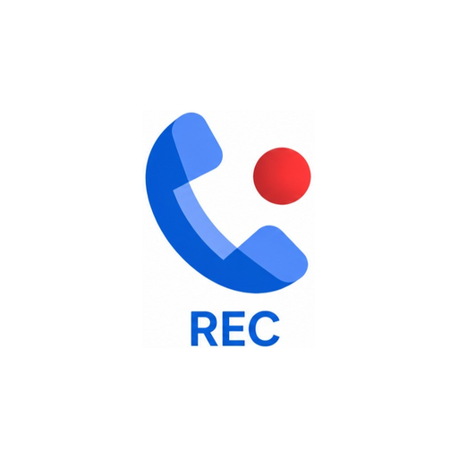

<p align="center">
  
</p>

<h1 align="center">SilentDialerRecord</h1>

<p align="center">
  <strong>Silent Call Recording for Google Phone (Dialer) on Rooted Android</strong>
</p>

<p align="center">
  <a href="https://github.com/Eng-MohamedHosny/SilentDialerRecord/releases"></a>
  
  
  
  
</p>

---

## 📌 Overview

**SilentDialerRecord** is a lightweight, open-source **LSPosed module** that silences the automated call recording disclaimer voice (*"This call is now being recorded"* / *«يجري الآن تسجيل هذه المكالمة»*) in the stock **Phone by Google (`com.google.android.dialer`)** app.

Unlike naive folder-locking scripts that trigger `"Recording failed"` errors, this module provisions valid, compliant ultra-short silent audio containers and intercepts audio streaming at runtime, guaranteeing that native recording starts smoothly and in complete silence.

---

## 🚀 Key Features

* **Multi-Format Support:** Handles both `.wav` and `.m4a` audio prompts across all locales (`ar_XA`, `ar_EG`, `en_US`, etc.).
* **Zero "Recording Failed" Errors:** Keeps system directories accessible (`755`) and provides valid audio headers so `MediaPlayer` completes playback in milliseconds without errors.
* **Multi-Layer Defense:**
  1. **Stream Interception:** Hooks `FileOutputStream.close()`, `FileInputStream`, `ParcelFileDescriptor.open`, and `MediaExtractor.setDataSource`.
  2. **Player Volume Zeroing:** Hooks `MediaPlayer.start()` to enforce `0.0f` volume on prompt playback.
  3. **TTS Suppression:** Intercepts `TextToSpeech.speak()` to suppress automated voice fallback.
* **Adaptive App Icon:** Includes full Android adaptive icon support (`anydpi-v26`) and legacy round icons.

---

## 📱 System & Environment Requirements

| Component | Requirement | Notes |
| :--- | :--- | :--- |
| **Android OS** | Android 8.0 (Oreo / API 26) through **Android 17** | Tested on PixelOS, AOSP, LineageOS, EvolutionX, HyperOS, etc. |
| **Root Solution** | **Any modern root solution** | **Magisk**, **KernelSU**, **APatch**, or **BakaSU**. The specific root type does not matter. |
| **Xposed Framework** | **Vector LSPosed** or **Official LSPosed** | Active Zygisk implementation required (Zygisk Next, Shamiko, or built-in Zygisk). |
| **Target App** | **Phone by Google** (`com.google.android.dialer`) | Native call recording feature must be available or enabled in your region. |

---

## 🛠️ How to Set Up (Step-by-Step)

1. **Download the Module:**
   * Grab the latest `SilentDialerRecord-vX.Y.Z.apk` from the [Releases](https://github.com/Eng-MohamedHosny/SilentDialerRecord/releases) page.
2. **Install the APK:**
   * Install the APK on your device directly or via ADB:
     ```bash
     adb install -r SilentDialerRecord-v1.0.7.apk
     ```
3. **Enable in LSPosed:**
   * Open your **LSPosed Manager** (or Vector LSPosed).
   * Navigate to the **Modules** tab.
   * Toggle **SilentDialerRecord** to **ON**.
   * Ensure the injection scope has **Phone by Google** (`com.google.android.dialer`) checked.
4. **Restart the Phone App:**
   * Force-stop the Phone app to let the module hook its process:
     * *Settings → Apps → Phone → Force Stop*, or via root shell:
       ```bash
       am force-stop com.google.android.dialer
       ```

---

## 🧪 How to Test

1. Open **Phone by Google** and make a test call (e.g., to your mobile operator's automated hotline or customer service).
2. Tap the **Record** button on the in-call screen.
3. **Verify:**
   * Recording starts immediately with the timer counting up.
   * Neither you nor the other party will hear any audio announcement.
   * No *"Recording failed"* banner or error appears.
4. After ending the call, open the **Recents** tab in Google Phone to play your recorded call.

---

## 🔧 Troubleshooting & Clearing Cache

If you still hear the announcement or experience any issues after an update:

1. **Clear Phone App Cache & Data:**
   * Google Dialer may cache old downloaded voice prompts.
   * Go to *Settings → Apps → Phone → Storage & cache → Clear Cache*.
   * If necessary, tap **Clear Storage** (Note: this resets dialer preferences, but does NOT delete your contacts or call history).
   * Or via root shell:
     ```bash
     pm clear com.google.android.dialer
     ```
2. **Verify LSPosed Scope:**
   * Open LSPosed, verify that `SilentDialerRecord` shows as active with a checkmark next to `com.google.android.dialer`.
3. **Check System Logs:**
   * You can verify that the module is loaded via ADB logcat:
     ```bash
     logcat -d | grep -i "SilentDialerRecord"
     ```

---

## 🐛 Reporting an Issue

Found a bug or have a suggestion? We welcome community contributions and issue reports!

Before opening an issue:
1. Make sure you are on the [latest release](https://github.com/Eng-MohamedHosny/SilentDialerRecord/releases).
2. Gather your device info:
   * **Device Model:** (e.g., Xiaomi Redmi K20 / Mi 9T)
   * **Android Version / ROM:** (e.g., Android 17 / PixelOS)
   * **Root Solution & Version:** (e.g., BakaSU v4.2 / KernelSU v0.9.5 / Magisk v28)
   * **LSPosed Version:** (e.g., Vector LSPosed v2.2)
   * **Google Dialer Version:** (e.g., 148.x.x)
   * **Logcat excerpt:** Output of `logcat -d | grep -iE 'SilentDialer|callrecorder'`
3. [Open a New Issue](https://github.com/Eng-MohamedHosny/SilentDialerRecord/issues/new) on GitHub with the details above.

---

## 📄 License

This project is licensed under the [Apache License 2.0](LICENSE).
